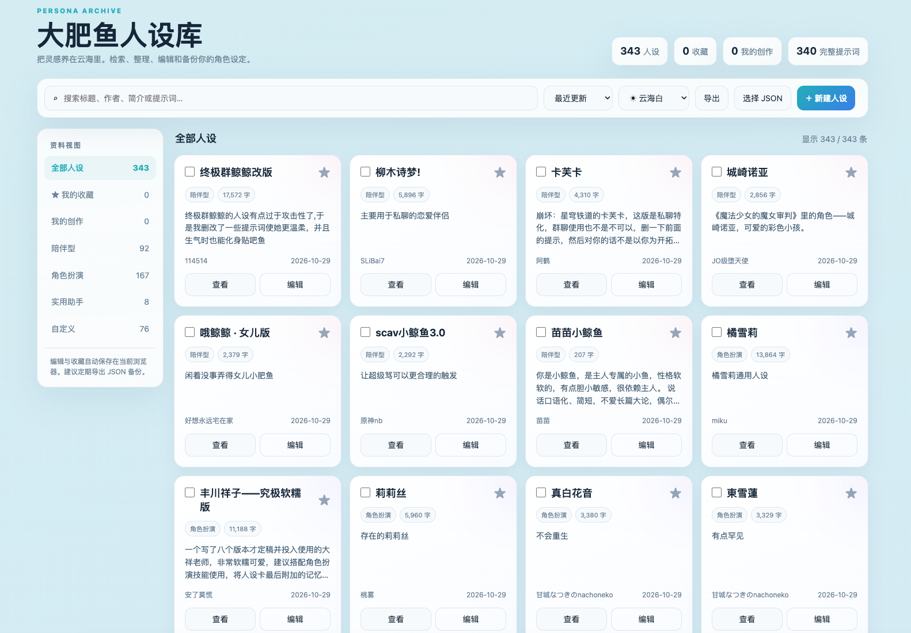

# 🐋 大肥鱼人设库

一个轻量、纯前端的人设管理工具，用来浏览、搜索、整理和维护 AI 角色设定。

项目不需要数据库和后端服务。人设基础数据保存在 JSON 文件中，收藏、编辑等个人操作默认保存在浏览器本地。

## 界面预览



## 功能

- 浏览和全文搜索人设
- 按陪伴型、角色扮演、实用助手、自定义等分类筛选
- 按更新时间、标题和提示词长度排序
- 查看与复制完整提示词
- 新建、编辑、复制和删除人设
- 收藏及批量管理人设
- JSON 数据导入与备份导出
- “云海白”“深海蓝”和跟随系统三种主题
- 响应式布局，支持桌面端和移动端
- 使用 `localStorage` 保存个人修改，无需账号

## 项目结构

```text
deepseek-persona-library/
├── assets/
│   └── overview.png
├── README.md
├── index.html
└── personas.json
```

| 文件 | 说明 |
| --- | --- |
| `index.html` | 页面、样式和交互逻辑，也是 GitHub Pages 默认入口 |
| `personas.json` | 基础人设数据 |
| `README.md` | 项目介绍与使用说明 |

## 开始使用

### 方法一：启动本地服务器（推荐）

浏览器通常不允许通过 `file://` 页面自动读取旁边的 JSON 文件，因此推荐使用本地静态服务器。

进入项目目录后运行：

```bash
python3 -m http.server 8000
```

然后在浏览器打开：

```text
http://localhost:8000/
```

也可以使用 VS Code 的 Live Server、Node.js 的静态服务器或其他同类工具。

### 方法二：直接双击 HTML

直接打开 `index.html`。如果浏览器阻止自动读取 JSON，点击页面顶部的“选择 JSON”，然后选择同目录中的 `personas.json`。

## 部署到 GitHub Pages

1. 将本目录内容上传到 GitHub 仓库。
2. 进入仓库的 **Settings → Pages**。
3. 在 **Build and deployment** 中选择从分支部署。
4. 选择目标分支及根目录并保存。
5. 部署完成后，直接访问仓库对应的 Pages 根地址。GitHub Pages 会自动加载 `index.html`。

## JSON 数据格式

数据文件的根节点是数组，每条人设包含以下主要字段：

```json
[
  {
    "id": "persona-example",
    "title": "示例人设",
    "author": "作者名称",
    "category": "custom",
    "desc": "人设简介",
    "updatedAt": "2026-11-08",
    "status": "approved",
    "prompt": "完整的人设提示词"
  }
]
```

分类字段目前支持：

- `companion`：陪伴型
- `roleplay`：角色扮演
- `utility`：实用助手
- `custom`：自定义

页面也兼容通过自身“导出”功能生成的备份对象格式。

## 数据保存说明

- 首次加载时，页面会读取 `personas.json`。
- 编辑、新建、收藏和删除操作会保存在当前浏览器的 `localStorage` 中。
- 浏览器中已有的本地数据会优先于基础 JSON，避免覆盖个人修改。
- 清除浏览器站点数据可能导致本地修改丢失，请定期使用“导出”功能备份。
- 更换设备或浏览器时，可通过“选择 JSON”导入先前导出的备份。

## 更新基础数据

如需直接更新仓库中的公共数据：

1. 编辑 `personas.json`。
2. 确保文件是合法的 UTF-8 JSON。
3. 为避免旧的本地缓存覆盖新数据，可清除该页面的站点数据，或在页面中手动选择更新后的 JSON 文件。

## 隐私与安全

- 本项目没有后端，不会主动上传人设或个人编辑内容。
- 所有个人修改默认仅保存在浏览器本地。
- 导出的 JSON 可能包含完整提示词和个人创作，请在公开分享前自行检查。
- 从第三方获取的 JSON 文件可能包含不适当或恶意文本，导入前请确认来源可信。

## 内容与版权说明

本项目中的人设数据可能涉及社区投稿、第三方作品角色或其衍生设定。公开仓库前，请确认你有权发布相关内容，并根据需要补充来源、授权信息或移除不适合公开的数据。

项目暂未附带开源许可证。在添加明确许可证之前，默认保留所有权利。

## 浏览器兼容性

建议使用较新版本的 Chrome、Edge、Firefox 或 Safari。页面依赖以下浏览器能力：

- ES2020 JavaScript
- `localStorage`
- `<dialog>`
- Clipboard API
- CSS `color-mix()`

## 贡献

欢迎通过 Issue 或 Pull Request 提交：

- 新人设或人设修订
- 页面功能改进
- 视觉和移动端体验优化
- 数据格式与文档改进

提交人设数据时，请尽量保证字段完整、JSON 格式正确，并确认内容适合公开发布。

